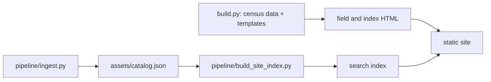

<div align="center">

# Unbuilt

**A census of human making — what the world has already built, and what it is still missing.**

[](https://adineo-cmd.github.io/unbuilt/)
  

[](https://github.com/adineo-cmd/unbuilt/stargazers) [](https://github.com/adineo-cmd/unbuilt/commits)

[Live site](https://adineo-cmd.github.io/unbuilt/) · [Quick start](#quick-start) · [How it works](#how-it-works) · [Features](#features)

</div>

---

Most people build the same ten visible things in every field. This is a field
guide to the rest: **328 ideas across 20 fields**, each split three ways —
already built, half-built, and not built yet.

The Shelves section backs the "already built" claim with real catalog data
rather than vibes.

## Features

| | Feature | What it does |
| --- | --- | --- |
| 🗂️ | **328 ideas, 20 fields** | Software, AI, hardware, health, climate, education, money, food, cities, robotics, accessibility, media — plus law & justice, textiles, death & legacy, oceans, parenting, travel & borders, space, arts & culture. |
| 🚦 | **Three states** | Solid: stop adding. Outlined: finish it. Dashed: the empty lane. |
| 📚 | **Shelves catalog** | Real apps and devices from Flathub, F-Droid, the App Store, npm and iFixit. |
| 🧩 | **First-class reasoning** | Every idea names the blocker that keeps it open. |
| 🗺️ | **Idea atlas tab** | 855 known, debated and undiscovered ideas merged from the Idea Atlas — filter by state or field, or search them all. |

## How it works

One Python script builds the whole site:

1. `build.py` holds the census data (`FIELDS`, `HALF`) and the page templates.
2. It writes every HTML page plus `assets/` — styles, search index and app logic.
3. `pipeline/ingest.py` pulls 13 open catalogs; `pipeline/build_site_index.py`
   merges them into sharded `assets/catalog/` and `data/catalog.db` (with a full-text index).
4. `pipeline/mine_gaps.py` measures every not-built claim against the catalog;
   `pipeline/gh_signal.py` counts GitHub repos per idea; `pipeline/classify.py`
   assigns listings to fields for the per-genre shelves sections.
4. Generated HTML is never hand-edited; the data is the source.



## Quick start

**Build and serve**

```bash
python3 build.py
python3 -m http.server 8412       # http://127.0.0.1:8412
```

**Rebuild the shelves**

```bash
python3 pipeline/ingest.py             # 13 catalogs: stores, GitHub, HumanWeb, hardware, food
python3 pipeline/build_site_index.py   # merge -> shards + SQLite + full-text index
python3 pipeline/mine_gaps.py          # measure every not-built claim against the catalog
python3 pipeline/gh_signal.py          # GitHub demand signal per idea
python3 pipeline/classify.py           # per-field extracted evidence
```

## Project structure

```text
build.py              census data + page templates
fields/               generated field pages
pipeline/             catalog ingestion and index build
assets/               styles, app logic, sharded catalog, evidence files
data/                 full catalog database (SQLite + FTS5)
```

## Deployment

Every push to `main` builds the site and deploys it to GitHub Pages
through `.github/workflows/deploy.yml`:

**https://adineo-cmd.github.io/unbuilt/**

## What the three columns mean

| Column | Meaning |
| --- | --- |
| **Already built** | Mature products, many competitors. Stop adding. |
| **Half-built** | It exists, but too expensive, locked to one country, or stuck at pilot scale. |
| **Not built yet** | The empty lane — with the blocker that keeps it open. |
